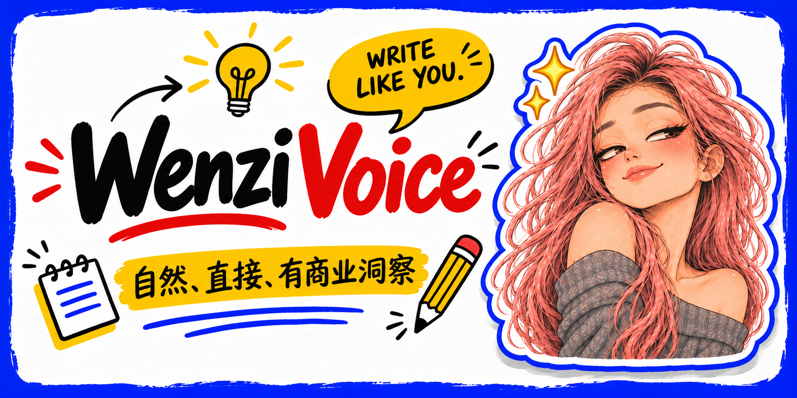

# Wenzi Voice



把零散口述、原始观点和未完成草稿，整理成自然、直接、有商业洞察的中文内容。

它不是一套“爆款模板”，也不是金句生成器。它更在意一件事：**保留作者真实的判断，让文字像一个持续在一线做事的人说出来。**

适用于朋友圈、公众号、小红书、X / 微博长短文与视频口播，可安装到 Codex、Claude Code 及其他兼容 Agent Skills 的环境。

## 关于使用

这套 Skill 主要是文子的个人自用工具。它来自文子自己的表达习惯、商业经历和长期创作校准，并不是一套适用于所有人的通用写作模板。

我把它公开出来，是因为它的设计方法也许能给你一些启发。如果你喜欢，可以下载、研究和参考它的结构；但更建议你把它当作一个起点，重新放入自己的经历、判断和最终稿，慢慢校准成属于你的 Voice。

**可以借鉴方法，不必复制文子。** 请不要直接照搬文子的个人经历、身份信息、校准记录或头像素材。真正有价值的不是模仿某几句话，而是让工具逐渐理解你自己是怎么思考、怎么说话的。

## 它解决什么问题

很多写作工具会把有生命力的原话，改成一篇工整但没有作者的“标准自媒体文案”：

- 每段一句话；
- 开头制造焦虑；
- 中间堆满排比和金句；
- 结尾强行升华；
- 换一个作者名字依然成立。

Wenzi Voice 反过来工作：

- 先保留立场，再整理表达；
- 用经历、产品、客户、交易与交付支撑商业判断；
- 不编造事实，不替作者虚构人设；
- 不自动添加 CTA、标签、emoji 和固定口号；
- 到意思讲完的地方就停。

## 风格底色

| 维度 | Wenzi Voice 的选择 |
|---|---|
| 语气 | 自然口语，不端着 |
| 观点 | 直接、清楚，但不靠训人制造力量 |
| 内容 | 从真实经历和一线实践出发 |
| 商业感 | 落到产品、客户、成交、交付、选择与代价 |
| 结构 | 服从本次内容，不套固定公式 |
| 结尾 | 自然收住，不强行鸡汤或号召 |

## 一个简单示例

原始口述：

> 人和人的价值连接，长久链接终究不能脱离产品。品，能落地，着陆，能持久，能有抓力。

整理方向：

> 人和人的价值连接想要长久，终究不能只靠聊天和认同，它要有一个具体的东西承接。
>
> 对我来说，这个东西就是产品和项目。产品让价值能够交付、被检验，也让一次表达有机会变成长期合作。项目又会逼着我回到一线，继续碰问题、找答案。
>
> 所以我的输入和输出不是两件事。输入推动我做事，做事产生新的输出，输出再回到产品里。

这里没有额外编造履历，也没有把“价值、产品、闭环”写成空洞口号，而是把它们落到了交付、检验和持续实践。

## 安装

下载仓库后，复制完整的 [`wenzi-voice`](./wenzi-voice/) 文件夹。不要只复制 `SKILL.md`，风格指南、正反例和校准机制也需要保留。

### Codex

全局使用：

```text
~/.agents/skills/wenzi-voice/
```

仅当前项目使用：

```text
.agents/skills/wenzi-voice/
```

部分 Codex 环境也使用 `~/.codex/skills/`。如果你已经有固定的技能目录，沿用当前环境即可。

### Claude Code

全局使用：

```text
~/.claude/skills/wenzi-voice/
```

仅当前项目使用：

```text
.claude/skills/wenzi-voice/
```

安装后开启一个新会话，让环境重新发现 Skill。

## 调用

最简单的方式是显式写出 `$wenzi-voice`：

```text
用 $wenzi-voice 把下面这段口述整理成一条朋友圈。
保留我的判断，不要编经历，不要强行升华。
```

```text
用 $wenzi-voice 修改这篇公众号文章。
把抽象概念落到业务细节，结尾到观点讲完就停。
```

```text
用 $wenzi-voice 把这段内容改成视频口播。
不要写成书面稿，保留自然停顿和我的原话。
```

## 最终稿校准

Wenzi Voice 不会把 AI 旧稿直接当成你的风格。它采用以下证据顺序：

1. 你明确确认的最终稿与逐句修改；
2. 你在当前任务中的原话、立场和事实；
3. 你明确认可的历史内容；
4. 未经确认的历史草稿；
5. AI 生成稿，只能作为待验证假设或反例。

当你亲自改完一篇稿子，可以这样反馈：

```text
这是我的最终稿。
请按 wenzi-voice 的校准机制对比你的版本，只记录可复用的变化，
不要把这一次的句式变成固定模板。
```

已确认的偏好会记录在 [`calibration-log.md`](./wenzi-voice/references/calibration-log.md) 中。一次修改只形成候选规则；同类偏好再次出现，或你明确说“以后都这样”，才会升级为稳定规则。

## 文件结构

```text
wenzi-voice/
├── SKILL.md
├── agents/
│   └── openai.yaml
└── references/
    ├── style-guide.md
    ├── examples.md
    ├── calibration.md
    ├── calibration-log.md
    └── compatibility.md
```

- [`SKILL.md`](./wenzi-voice/SKILL.md)：入口规则与交付标准
- [`style-guide.md`](./wenzi-voice/references/style-guide.md)：完整语感和商业表达指南
- [`examples.md`](./wenzi-voice/references/examples.md)：正反例及判断依据
- [`calibration.md`](./wenzi-voice/references/calibration.md)：用户最终稿校准机制
- [`compatibility.md`](./wenzi-voice/references/compatibility.md)：Codex、Claude Code 与其他环境适配

## 设计原则

- **风格不是口头禅。** 不维护可批量复用的“文子金句库”。
- **结构不能代替思考。** 不把每篇内容装进同一个钩子和结尾。
- **事实不能为文采让路。** 素材没有的成绩、案例和情绪不补写。
- **锋利必须有来路。** 重话要有对象、条件和真实经验支撑。
- **校准必须可撤销。** 不把一次修改过度泛化成永久规则。

## 完整说明

- [安装与使用](./安装与使用.md)
- [跨环境兼容说明](./wenzi-voice/references/compatibility.md)

本 Skill 采用标准 `SKILL.md` 结构，不依赖外部服务或专属模型能力。

